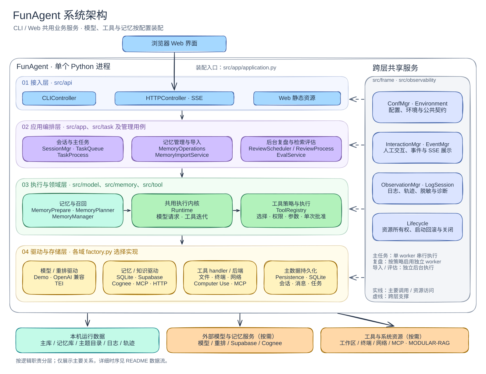
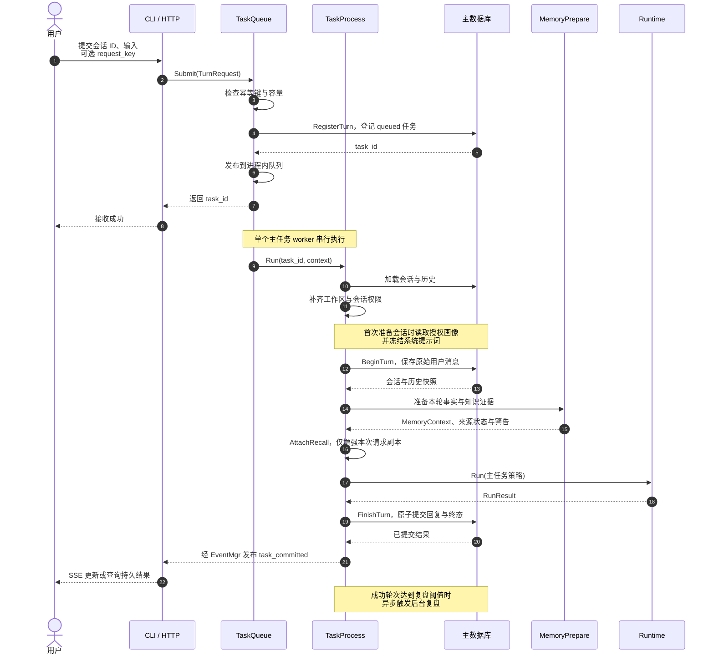
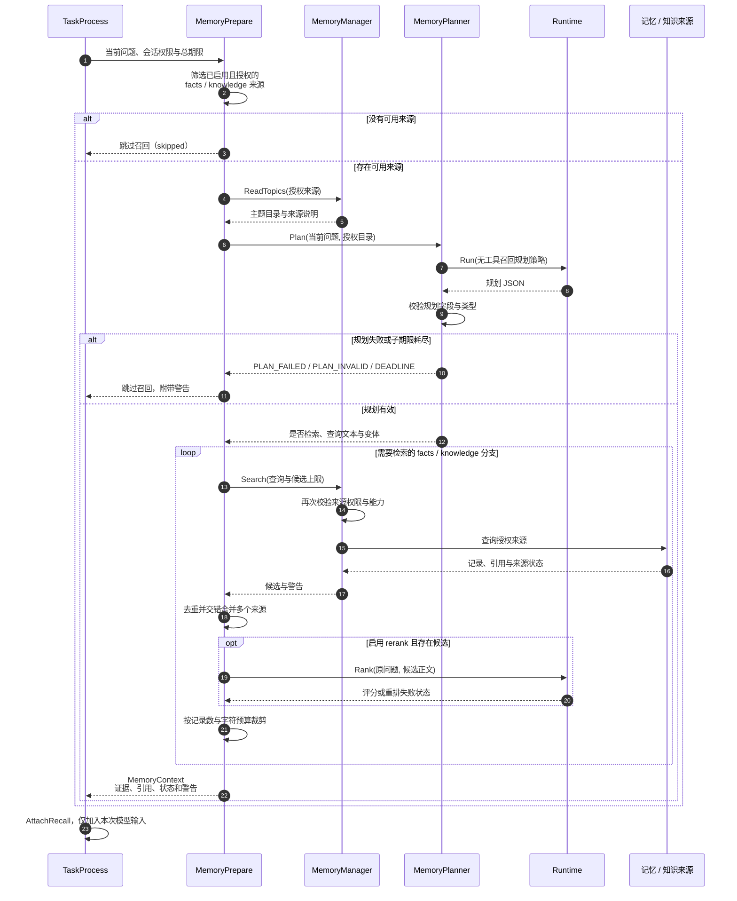
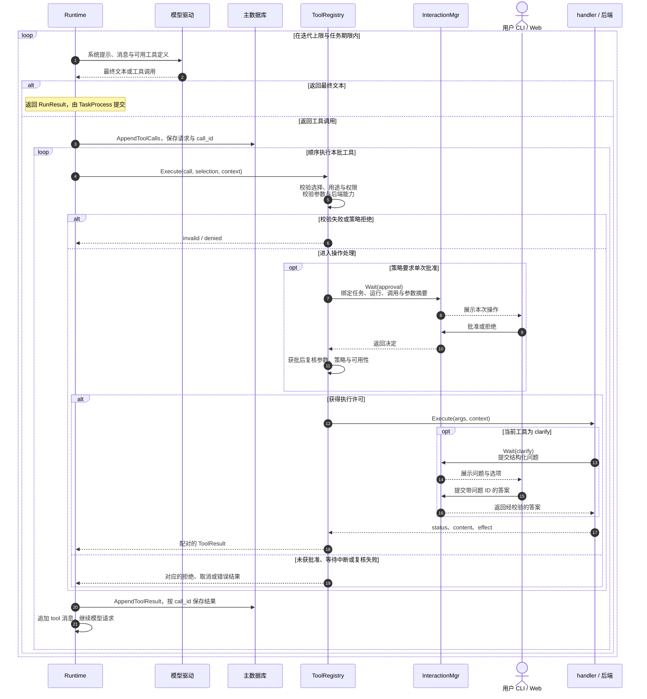
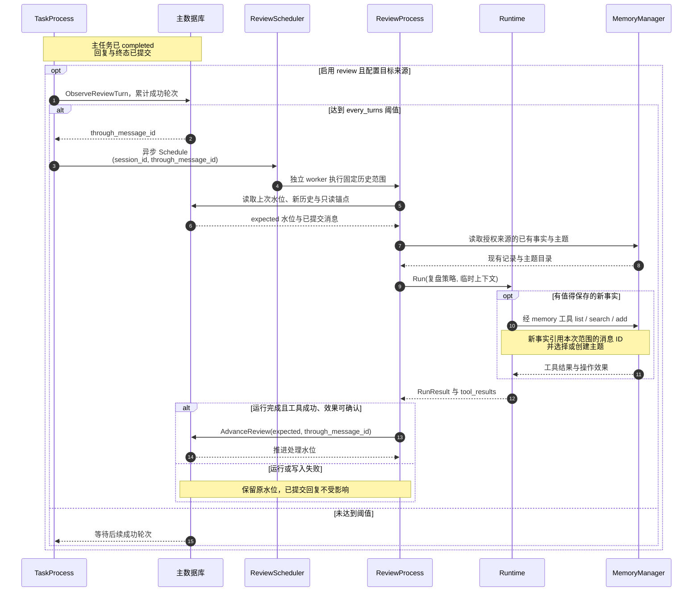
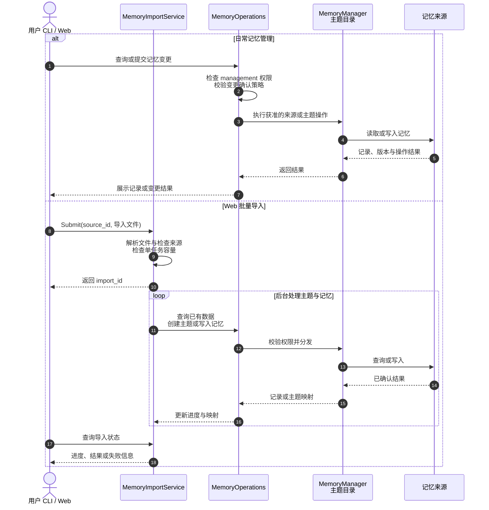
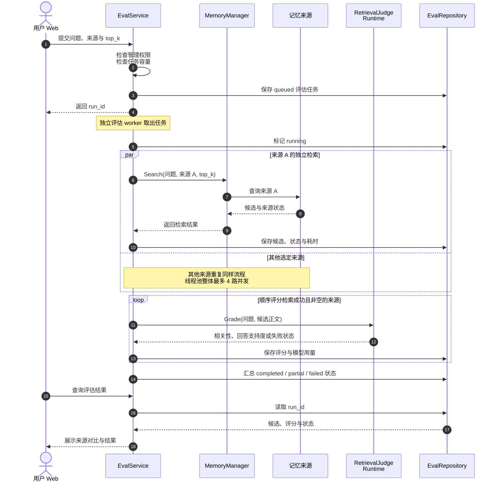

# FunAgent

FunAgent 是面向本机运行的单进程 Python Agent，通过 CLI 和 Web 提供持久对话、异步任务、工具调用与长期记忆，支持人工澄清和单次操作批准。浏览器界面随 Python 包提供，无需单独构建前端。

首次使用从[快速启动](#快速启动)开始；开发者可从[架构设计](#架构设计)、[数据流](#数据流)和[开发指南](#开发指南)了解执行过程与扩展入口。

- [快速启动](#快速启动)
- [架构设计](#架构设计)
- [数据流](#数据流)
- [配置与扩展](#配置与扩展)
- [开发指南](#开发指南)
- [常见问题](#常见问题)

## 快速启动

准备 **Python 3.11–3.13** 和已加入 `PATH` 的 **uv**，在项目根目录的 **PowerShell** 中执行。首次安装依赖需要联网；Demo 运行无需 API Key、Docker 或外部记忆服务。

```powershell
New-Item -ItemType Directory -Force .funagent/quickstart | Out-Null
Copy-Item -Path examples/quickstart/*.conf -Destination .funagent/quickstart
uv run --locked funagent --conf-dir .funagent/quickstart --check-config
uv run --locked funagent --conf-dir .funagent/quickstart
```

前两条命令仅用于首次复制[最小配置](examples/quickstart/)，后续启动只需最后一条。校验成功打印 `Configuration valid.`；服务启动后打开 [http://127.0.0.1:7777](http://127.0.0.1:7777)，新建会话并发送：

| 输入 | 预期结果 |
| --- | --- |
| `hello` | 回复 `Demo: hello` |
| `tool:hello` | 调用 `echo`，返回 `hello` |
| `read:pyproject.toml` | 读取项目文件 |
| `ask:Which language?` | 显示澄清问题，填写后继续执行 |

Demo 按固定规则响应，用于验证运行链路。会话、任务和日志保存在 `.funagent/quickstart/`，长期记忆需另行配置。按 `Ctrl+C` 停止服务；接入真实模型见[模型配置](#接入真实模型)。

示例的 `workspace = "."` 指启动时的工作目录，请始终从项目根目录运行。需要固定工作区时，将 `.funagent/quickstart/serv.conf` 的 `workspace` 改为本机已有目录的绝对路径。

<details>
<summary>使用 CLI</summary>

将 `.funagent/quickstart/serv.conf` 的 `mode` 改为 `"both"`，重启后同时使用 Web 和 CLI；设为 `"cli"` 则只启动 CLI。

```text
new 我的第一个会话
submit <session_id> hello
wait <task_id>
history <session_id>
help
quit
```

`new` 返回会话 ID，`submit` 返回任务 ID；将尖括号占位符替换为实际 ID。`wait` 等待结果，并处理任务中的澄清或批准请求。

</details>

## 架构设计

FunAgent 将用户输入作为可查询、可取消的任务处理。CLI 和 Web 共用业务服务；模型、工具和记忆通过协议与工厂装配。对话历史与任务状态由主数据库保存，长期记忆使用单独配置的来源。

### 整体架构图

下图按当前源码绘制。FunAgent 内部模块运行在同一个 Python 进程中；主任务由一个 worker 串行执行，复盘、记忆导入和检索评估使用各自的后台执行路径。外部服务按配置启用。



架构图使用本地 Excalidraw 绘制，提供[可编辑源文件](docs/architecture.excalidraw)。实线表示主要调用或资源访问，虚线表示跨层支撑；仅展示主要关系，具体执行顺序见下方时序图。`src/app/application.py` 负责构造各域实现、绑定服务，并交给 `Lifecycle` 管理启动与关闭。

### 架构层次与源码入口

| 层次 | 职责 | 主要源码 |
| --- | --- | --- |
| 接入层 | 解析 CLI / HTTP 请求，提供 Web 页面、SSE 和管理接口 | `src/api/cli_controller.py`、`src/api/http_server.py`、`src/api/*_routes.py`、`src/api/web/` |
| 应用编排层 | 装配资源，管理会话、任务准入和排队，编排一轮执行及后台用例 | `src/app/application.py`、`src/task/`、`src/frame/session_mgr.py`、`src/frame/review_scheduler.py`、`src/memory/review_process.py`、`src/memory/memory_operations.py`、`src/memory/memory_import_service.py`、`src/eval/service.py` |
| 执行与领域层 | 运行模型与工具循环，规划召回，执行记忆授权和工具策略 | `src/model/runtime.py`、`src/memory/memory_prepare.py`、`src/memory/memory_planner.py`、`src/memory/memory_manager.py`、`src/tool/tool_registry.py` |
| 驱动与存储层 | 转换模型协议，连接记忆来源和工具后端，持久化会话与任务 | 各域的 `factory.py`、`src/model/openai_chat.py`、`src/memory/{sqlite,supabase,cognee,mcp_query,http_query}.py`、`src/tool/backends/`、`src/persistence/` |
| 跨层共享服务 | 提供配置、公共契约、人工交互、事件、观测与资源生命周期 | `src/frame/`、`src/observability/` |

目录按业务域组织，因此同一目录可能包含多个层次的代码：例如 `memory_prepare.py` 负责召回编排，`memory_manager.py` 负责来源授权与分发，`memory/sqlite.py` 实现具体存储。

开发时遵循以下约定：

- `contracts.py` 定义数据结构，`protocols.py` 定义使用方接口，`factory.py` 按配置选择实现；可选依赖在选用时加载。
- `ModelRuntime` 和 `MemoryMgr` 等提供已装配服务的访问入口，实际执行分别由 `Runtime`、`MemoryManager` 等实现承担。
- 主任务、召回规划和后台复盘复用执行内核，分别使用自己的策略、上下文、工具范围和预算。召回规划不调用工具。
- 主数据库保存持久结果；事件和 SSE 负责界面更新，轨迹保存执行过程。后台处理失败不会改写已提交的主任务回复。

## 数据流

以下 Mermaid `sequenceDiagram` 按源码中的调用与提交顺序绘制，源文件位于 [`docs/data-flows/`](docs/data-flows/)。实线箭头表示请求，虚线箭头表示返回或展示通知。

### 1. 一次对话如何完成

用户输入先持久化登记，再进入主任务队列；最终回复与任务终态一起提交。



同一会话内，相同 `request_key` 和输入复用原任务，输入变化则冲突。重启会修复中断任务状态，保留已提交数据，不自动重放工具调用。

### 2. 记忆如何进入模型上下文

画像在会话首次准备提示词时单独加载并冻结；以下展示每轮事实与知识的召回。



来源或重排失败时尽量保留可用结果；父任务取消或总期限耗尽会终止本轮。持久历史中的用户输入保持原文。

### 3. 工具调用与人工交互如何闭环

模型提出调用后，由工具服务校验和执行；批准与澄清通过 CLI / Web 交回原调用。



此图展示主任务的记录路径；召回规划无工具，复盘使用临时消息。工具结果记录 `effect`，无法确认的副作用保留为未知状态。

### 4. 对话如何沉淀为长期记忆

后台复盘只处理已提交的历史范围，主任务回复无需等待。



后台工具仅允许查询和新增事实，不能改删既有事实。正常完成且没有新事实时也会推进水位；只读历史锚点仅用于理解指代。

### 5. 记忆如何管理与批量导入

管理用例使用 `session_access.management` 权限；批量导入由独立 worker 执行。



### 6. 检索结果如何评估与追踪

应用内检索评估独立排队，保存每个来源的候选、评分和状态。



评估记录位于配置目录的 `.funagent/eval.sqlite3`。主任务阶段、模型请求和工具 IO 另由 `src/observability/` 采集为轨迹，可通过诊断接口、日志和轨迹页面排查。

<details>
<summary>常用 HTTP 入口</summary>

HTTP 路径直接位于根路径下，浏览器使用同一套接口。

| 方法与路径 | 用途 |
| --- | --- |
| `POST /sessions`、`GET /sessions` | 创建、列出会话 |
| `POST /sessions/{id}/tasks` | 提交 `{"text":"hello","request_key":"first-turn-1"}`，返回任务 ID；`request_key` 可省略 |
| `GET /tasks/{id}`、`POST /tasks/{id}/cancel` | 查询结果、请求取消 |
| `GET /sessions/{id}/messages` | 读取会话历史 |
| `GET /tasks/{id}/events` | 订阅任务 SSE 事件 |
| `GET /tasks/{id}/interactions` | 查询待处理交互 |
| `POST /interactions/{id}/answer` | 提交 `task_id`、`run_id` 和 `answer` |
| `GET /diagnostics/status` | 运行状态；同类视图包括 tools、connections、models、config、memory |
| `/memory/*`、`/data/*`、`/traces`、`/eval/*` | 记忆管理、只读数据、轨迹与检索评估，方法见相应路由模块 |

</details>

## 配置与扩展

`--conf-dir` 指向包含以下五份文件的目录。扩展名为 `.conf`，内容格式为 **UTF-8 TOML**；最小示例见 [`examples/quickstart/`](examples/quickstart/)。

| 文件 | 主要配置 |
| --- | --- |
| `serv.conf` | `[options]`：运行模式、监听地址、工作区、主数据库、队列容量、模型 profile、迭代与超时限制 |
| `model.conf` | `adapters`、`providers`、`profiles`：模型协议、连接、超时、重试、流式输出和备用 profile |
| `tool.conf` | `toolsets`、`purposes`、`session_access`、`tools`、`backends`：工具选择、权限和后端 |
| `memory.conf` | `sources`、`policies`、`topics`：记忆来源、召回 / 复盘策略和主题目录 |
| `log.conf` | `[options]`：日志输出、脱敏与轮转；`[observability]`：轨迹容量等限制 |

主数据库、SQLite 记忆、日志和主题目录的相对路径以配置目录为基准。`workspace` 的相对路径以及 MCP 的 `command`、`cwd` 等需结合启动进程的工作目录配置。

实际启动加载 `<配置目录>/.env`，已有的进程环境变量优先。`credential_env` 填环境变量名，凭据值放在该目录的 `.env` 或进程环境中；快速启动不会自动加载项目根目录的 `.env`。

### 接入真实模型

将 `.funagent/quickstart/model.conf` 替换为以下内容，填写服务地址和模型名：

```toml
adapters = ["openai_chat"]

[providers.chat]
kind = "openai"
base_url = "https://your-openai-compatible-host/v1"
credential_env = "OPENAI_API_KEY"

[profiles.primary]
provider_id = "chat"
adapter_id = "openai_chat"
model = "your-chat-model"
timeout = 60.0
max_retries = 2
streaming = true
fallback_profiles = []
```

在同一 PowerShell 窗口设置凭据并启动：

```powershell
$env:OPENAI_API_KEY = "替换为你的密钥"
uv run --locked --extra openai funagent --conf-dir .funagent/quickstart
```

也可将 `OPENAI_API_KEY=...` 写入 `.funagent/quickstart/.env`。服务需兼容 Chat Completions，所选模型需支持配置的工具和流式输出能力。`max_retries = 2` 表示最多重试两次；备用 profile 必须在同文件中声明。

### 工具与权限

工具须同时满足选择规则、用途、会话权限和后端能力。`purposes` 区分 `main`、`recall`、`review`；`session_access.default` 是普通会话默认权限，`management` 用于管理用例，也可以按会话 ID 配置权限。

```toml
[purposes.main]
toolsets = ["default", "workspace", "interaction"]
enable = ["echo"]
disable = ["memory"]

[session_access]
default = ["workspace.read"]
management = ["workspace.read"]
```

`default` 工具集包含计算和时间工具，`workspace` 提供工作区文件工具，`interaction` 提供澄清；也可像 Demo 一样直接列出工具名。`[tools.<工具名>]` 可绑定 `backend_id` 或要求批准，`[backends.<id>]` 声明连接。

MCP 支持 `stdio`、`streamable_http` 和 `sse`。根目录配置中的 RAG 后端使用独立 Python 环境，启动时发现工具；其隐藏查询工具由固定召回流程调用。依赖与配置分别见 `mcp_server/MODULAR-RAG/requirements.txt`、`mcp_server/MODULAR-RAG/config/settings.yaml`。

### 长期记忆

对话历史自动保存在主数据库中；长期记忆须单独声明来源、授权并写入内容。

| `store` | `kind` | 配置内容 |
| --- | --- | --- |
| `sqlite` | `episodic` | 本地记忆文件路径 |
| `supabase` | `episodic` | RPC 地址、namespace、凭据、Embedding 和数据库部署资产 |
| `cognee` | `episodic` | API 地址、datasets、令牌和超时 |
| `callback` | `semantic` | `http_json` 查询地址，或 `mcp` 的 backend、collection 与 top_k |

例如，将 `.funagent/quickstart/memory.conf` 替换为以下内容，可启用本地事实召回：

```toml
[sources.local]
kind = "episodic"
store = "sqlite"
path = "memory.sqlite3"
capabilities = ["search", "list", "write", "update", "delete"]
read_access = "memory.local.read"
write_access = "memory.local.write"
source_description = "本地项目记忆"

[policies.recall]
profile = "primary"
timeout = 30.0

[policies.facts]
enabled = true
sources = ["local"]
max_records = 10
max_chars = 4000
timeout = 10.0

[policies.review]
enabled = false
```

同时在 `tool.conf` 的 `session_access.default` 增加 `memory.local.read`，在 `management` 增加 `memory.local.read` 和 `memory.local.write`。重启后在 Memory 页面先创建主题，再添加记录；Demo 使用 `memory:关键词` 验证召回。

| 策略 | 作用 |
| --- | --- |
| `profile` | 首次准备会话提示词时加载画像，并随提示词冻结 |
| `recall` | 调用指定模型生成召回计划，不调用工具 |
| `facts` / `knowledge` | 分别检索事实 / 知识，控制来源、候选量、结果量、字符预算和超时 |
| `rerank` | 可选的候选评分，引用 `task = "rerank"`、`adapter_id = "tei_rerank"` 的 profile |
| `review` | 成功对话达到轮次阈值后后台复盘，目标须为已启用的 facts 来源并具备所需能力 |

启用复盘还需配置复盘模型 profile，并在 `purposes.review` 开放 `memory` 工具。主题目录默认为配置目录下的 `.funagent/memory-topics.json`。所有已声明的来源都会在启动时构造，停用召回策略不会移除对应来源及其依赖。

### 可选依赖与现有启动脚本

extras 可以组合，例如 `uv run --locked --extra openai --extra mcp funagent --conf-dir <配置目录>`。

| extra | 使用场景 |
| --- | --- |
| 无 | Demo、本地 SQLite、基础工具、CLI 和 Web |
| `openai` | OpenAI 兼容模型 |
| `mcp` | MCP 工具或知识召回 |
| `embedding`、`supabase`、`cognee`、`rerank` | 对应 HTTP 驱动所需的 `httpx` |
| `web` | 内置 Web 搜索与网页 / PDF 提取 |
| `dev` | pytest |
| `supabase-test` | Supabase 数据库契约验收 |

根目录的 `*.conf` 是依赖外部服务和本机路径的部署配置。使用前检查工作区、服务地址、凭据变量和 RAG 解释器路径。Supabase 部署说明见 [`sql/supabase/README.md`](sql/supabase/README.md)，迁移文件位于 `src/memory/assets/supabase/migrations/`。

| 入口 | 行为与前置条件 |
| --- | --- |
| `uv run --locked funagent --conf-dir <配置目录>` | 按指定配置运行，按所选驱动补充 `--extra` |
| `bash start.sh` | 安装 `openai/mcp/supabase/embedding/cognee` extras 后启动；不负责启动 Cognee，WSL 下使用宿主机 `uv.exe` |
| `.\start.cmd` | 先通过 `ensure-cognee.ps1` 检查、启动并登录 Cognee，再以相同 extras 启动；前置步骤失败则终止 |

`start.cmd` 检查 `127.0.0.1:8000/health`，必要时通过 `evals/services/cognee.compose.yml` 启动 Docker 服务，并将令牌写入 `.funagent/cognee-session.env`。Compose 还依赖宿主机 `1234` 端口的模型与 Embedding 服务；即使传入 `--check-config`，此脚本仍会先执行 Cognee 前置步骤。

## 开发指南

### 目录与阅读顺序

```text
FunAgent/
├── examples/quickstart/       # 可复制的五份最小 Demo 配置
├── src/
│   ├── __main__.py            # python -m src 入口
│   ├── app/                   # 参数解析、应用装配与启动关闭
│   ├── api/                   # CLI、HTTP、SSE、管理接口与 Web 页面
│   ├── frame/                 # 配置、契约、会话、交互、事件与生命周期
│   ├── task/                  # 主任务队列、执行编排与策略
│   ├── model/                 # 共用执行内核、模型与重排驱动
│   ├── memory/                # 授权、主题、召回、复盘、管理、导入与来源驱动
│   ├── tool/                  # 工具注册、校验、内置 handler 与后端
│   ├── persistence/           # 主数据库协议与 SQLite 实现
│   ├── observability/         # 轨迹采集、脱敏、存储与读取
│   └── eval/                  # 应用内检索评估与结果存储
├── mcp_server/MODULAR-RAG/    # 独立 RAG 项目、环境和配置
├── evals/                    # 独立评估 CLI、配置、数据和测试
├── scripts/                  # 发布、浏览器与迁移验收脚本
├── docs/                     # Excalidraw 架构图、Mermaid 时序图与专题设计
├── pyproject.toml / uv.lock   # 包定义、入口、依赖与锁定版本
├── start.cmd / start.sh      # 按根目录部署配置启动
└── .funagent/                # 本地配置与运行数据
```

建议按 `src/__main__.py` → `src/app/main.py` → `src/app/application.py` → `src/task/task_queue.py` → `src/task/task_process.py` → `src/model/runtime.py` 阅读主链路，随后按需阅读记忆或工具模块。

| 开发目标 | 从哪里开始 |
| --- | --- |
| 新增接口或页面 | `src/api/`、`src/api/web/`，复用已有业务用例 |
| 调整任务流程 | `src/task/task_process.py`、`src/task/main_strategy.py` |
| 新增模型或记忆驱动 | 对应域的 `protocols.py`、`contracts.py`、`factory.py` |
| 新增工具 | `src/tool/builtins/` 的 `register_tools(registrar)`；按需实现 `src/tool/backends/` 后端 |
| 排查运行行为 | `src/observability/`、诊断接口及任务轨迹 |

发行包和命令名是 `funagent`，Python 包名为 `src`。主应用与 MODULAR-RAG 各有一个 `src` 包，须使用各自环境和工作目录。详细文件职责见[源码导航](src/README.md)，长篇分析见[架构分析](ARCHITECTURE.zh-CN.md)，路径与行为以当前源码为准。

### 运行数据与验证

使用快速启动配置时，以下路径均相对于 `.funagent/quickstart/`：

| 路径 | 内容 |
| --- | --- |
| `agentcore.db` | 会话、消息、任务状态与复盘进度 |
| `logs/`、`trace_json/` | 应用日志与任务轨迹 |
| `.funagent/eval.sqlite3` | 应用内检索评估记录 |
| `memory.sqlite3`、`.funagent/memory-topics.json` | 启用上述本地记忆示例后生成的记忆与主题 |

可运行当前检出已有的应用内评估回归测试：

```powershell
uv run --locked --extra dev python -m pytest evals/tests/test_online_eval.py
```

独立评估入口为 `uv run --locked python -m evals --help`，提供数据集校验、run、score 和 compare。`scripts/` 中的验收脚本按各自 `--help` 准备依赖与输入。

`pyproject.toml` 声明的 `tests/`、`tests_refactor/`、`tests_observability/` 及构建脚本引用的 `examples/refactor*` 当前未提供，完整发布验收需补齐对应资源。根目录部署配置、部分文档和运行数据受 `.gitignore` 排除，交付前需检查所引用文件是否包含在交付范围内。

## 常见问题

| 现象 | 检查与处理 |
| --- | --- |
| `CONFIG_MISSING` | `--conf-dir` 中必须有 model、tool、memory、log、serv 五份 `.conf` 文件 |
| `CONFIG_INVALID` / `CONFIG_REFERENCE` | 检查 UTF-8 TOML、字段类型及跨文件引用，先运行 `--check-config` |
| 校验通过但实际启动失败 | `--check-config` 只验证格式与引用，不加载 `.env`、构造驱动或验证凭据、网络和工作区 |
| `CONFIG_CREDENTIAL` / `DRIVER_UNAVAILABLE` | 在配置目录 `.env` 或进程环境中设置凭据；按实际驱动添加 `--extra` |
| 新建会话提示工作区无效 | 检查 `serv.conf` 的 `workspace` 是否指向已有目录；相对路径需从正确目录启动 |
| RAG 或外部服务连接失败 | 检查 `logs/errors.log`、服务地址、MCP 解释器与 cwd；先用 Demo 配置验证基础链路 |
| 工具或记忆不可见 | 检查 purposes、toolsets、session_access、后端和记忆策略；CLI 可运行 `tools doctor`、`connections`、`memory check` |
| 没有自动生成长期记忆 | 检查 review 开关、轮次阈值、目标 facts 来源、复盘模型及 memory 工具；普通历史持久化不会自动写入长期记忆 |
| `7777` 端口占用 | 修改所用 `serv.conf` 的 `port` 后重启 |

文档核对日期：2026-10-17。最小配置已在 Python 3.12 下验证 Web / CLI 启动、上述四类 Demo 输入与重启后的持久数据读取；本地记忆示例已验证配置校验和启动。外部模型和远程服务需在对应环境中验证。
