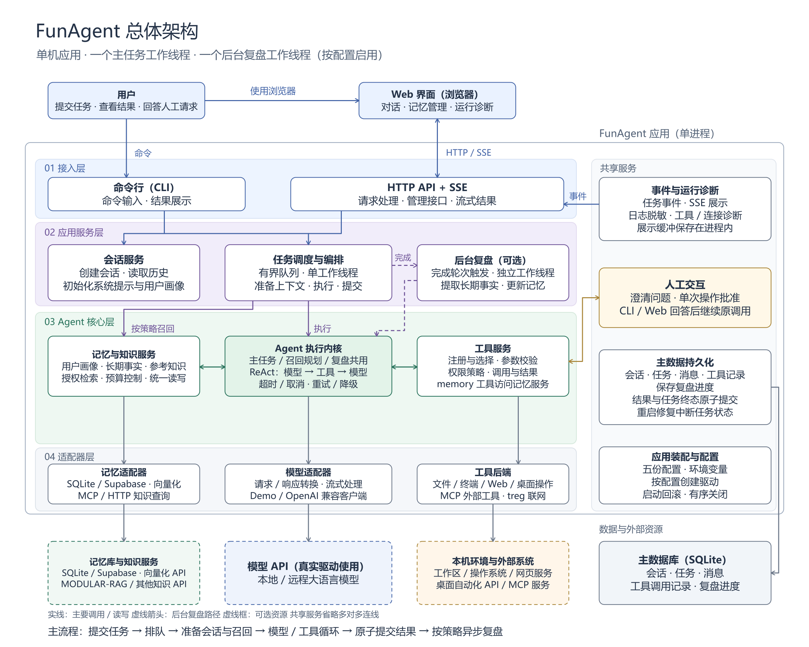
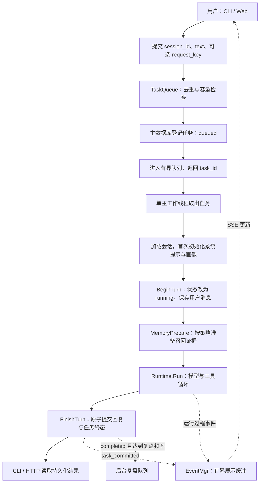
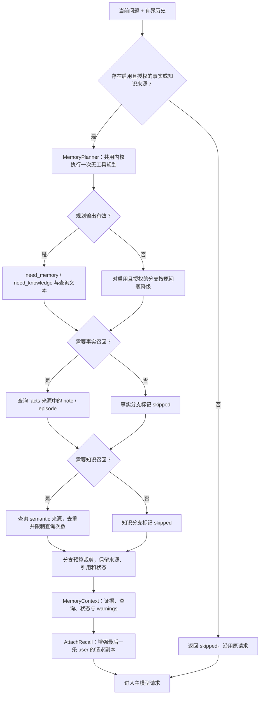
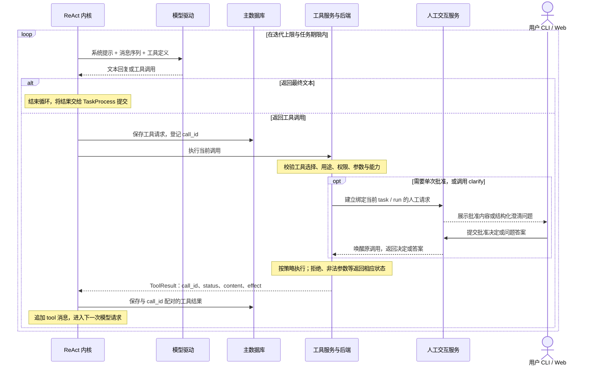
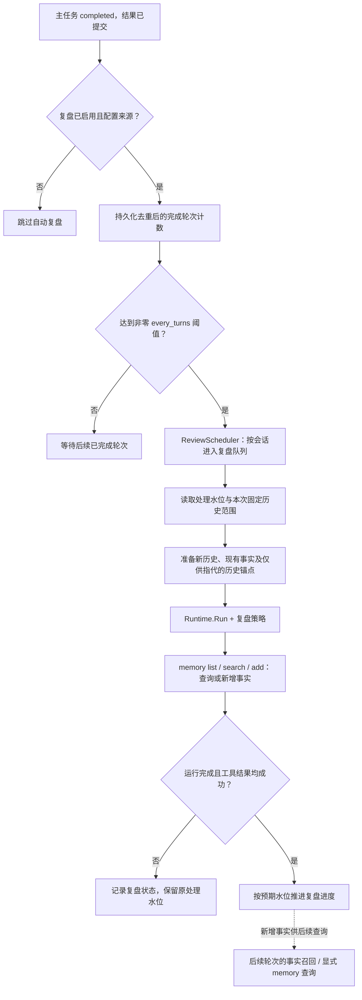

# FunAgent

FunAgent 是面向本机运行的 Agent 应用，通过 CLI 和 Web 提供持久对话、异步任务、工具调用与长期记忆，支持人工澄清和单次操作批准。

- [项目概述](#项目概述)
- [系统架构与模块设计](#系统架构与模块设计)
- [快速开始](#快速开始)
- [配置与能力扩展](#配置与能力扩展)
- [常用操作与接口](#常用操作与接口)
- [开发与验证](#开发与验证)
- [使用边界与常见问题](#使用边界与常见问题)
- [文档导航](#文档导航)

## 项目概述

### 核心能力一览

| 能力 | 说明 |
| --- | --- |
| 对话与任务 | CLI / Web 共享会话，支持异步排队、流式展示、取消和历史恢复 |
| 模型与工具 | 离线 Demo / OpenAI 兼容模型；文件、终端、联网、桌面操作及 MCP 工具 |
| 记忆与复盘 | 用户画像、事实和知识按策略召回；后台从已完成对话提取长期事实 |
| 人工交互与管理 | 澄清、单次批准，以及记忆管理、数据浏览和运行诊断 |

### 技术亮点

1. **共用 ReAct 内核：** 主任务、召回规划和复盘通过不同策略复用 `Runtime.Run`。
2. **模块与驱动解耦：** 业务域依赖协议，工厂选择具体实现，应用层统一装配和关闭资源。
3. **执行结果可追溯：** 回复与终态原子提交，工具请求与结果配对；权限、单次批准和记忆版本校验约束实际操作。

## 系统架构与模块设计

### 整体架构图



架构图从上到下分为四层，右侧为共享服务，底部为数据与外部资源。图中的模块表示同一应用进程内的逻辑职责；Web 界面运行在浏览器中，MODULAR-RAG 作为独立知识服务接入。

| 层次 | 模块与职责 | 主要源码 |
| --- | --- | --- |
| 接入层 | CLI 命令、HTTP 请求、SSE 订阅、Web 展示及管理接口 | `src/api/`、`src/api/web/` |
| 应用服务层 | 会话初始化、任务准入与排队、一轮任务编排、后台复盘调度 | `src/frame/session_mgr.py`、`src/task/`、`src/frame/review_scheduler.py` |
| Agent 核心层 | 共用 ReAct 内核、召回规划、记忆授权与管理、工具注册与分发 | `src/model/runtime.py`、`src/memory/`、`src/tool/tool_registry.py` |
| 适配器层 | 模型请求转换与 IO、SQLite / Supabase 存储、MCP / HTTP 查询、终端与网络等后端 | 各域的 `factory.py`、驱动文件及 `src/tool/backends/` |
| 共享服务 | 公共契约、配置、人工交互、事件、日志、诊断、主数据持久化和资源关闭 | `src/frame/`、`src/persistence/`、`src/app/` |

主任务由一个工作线程消费；启用后台复盘时，复盘另有一个工作线程。主任务、召回规划与复盘的运行上下文独立，共用模型执行机制及已装配的服务。

### 目录结构

```text
FunAgent/
├── README.md
├── pyproject.toml                 # 包定义、命令入口与可选依赖
├── uv.lock                        # 依赖锁定
├── start.cmd / start.sh            # 使用根目录配置启动
├── model.conf                     # 模型 provider、adapter 与 profile
├── tool.conf                      # 工具集、权限、批准策略与后端
├── memory.conf                    # 记忆来源、召回与复盘策略
├── log.conf                       # 日志输出与轮转
├── serv.conf                      # 运行模式、监听地址、队列与任务预算
├── src/
│   ├── __main__.py                # python -m src 入口
│   ├── app/                       # 应用装配、启动回滚与命令参数
│   ├── api/                       # CLI、HTTP、记忆管理、数据与诊断接口
│   │   └── web/                   # 浏览器页面，原生 ES Modules
│   ├── frame/                     # 公共契约、配置、会话、事件与生命周期
│   ├── task/                      # 主任务队列、执行编排与模型策略
│   ├── model/                     # ReAct 内核、流式累积与模型驱动
│   ├── memory/                    # 召回、复盘、管理、存储与查询驱动
│   ├── persistence/               # 主数据库协议与 SQLite 实现
│   └── tool/                      # 工具声明、选择、授权与分发
│       ├── builtins/              # 内置工具及 handler
│       └── backends/              # MCP、terminal、web、computer、treg 等
├── mcp_server/MODULAR-RAG/         # 独立 RAG 项目，不进入主应用发行包
├── docs/                          # 架构图、API、迁移说明与验收记录
└── pyproject.toml                  # 项目依赖与构建配置
```

建议按 `src/__main__.py → src/app/main.py → src/app/application.py` 阅读应用入口，再沿 `TaskQueue → TaskProcess → Runtime.Run` 阅读主执行链路。详细文件职责与导入约定见 [源码导航](src/README.md)。

### 数据流说明

下面按一条用户消息的生命周期展开。实线表示调用与数据传递，虚线表示展示事件或异步触发；各图中的主数据库、记忆服务和执行内核对应上方架构图中的同名职责。

#### 1. 主任务：提交、排队与准备



| 阶段 | 数据如何变化 | 关键规则 |
| --- | --- | --- |
| 提交与准入 | 用户输入转换为 `TurnRequest`；任务登记到主数据库，再发布到进程内队列 | 同会话内同键同内容返回原任务，不占新容量；同键异内容返回 `CONFLICT`；容量统计包含排队和运行中的任务 |
| 工作线程取任务 | 为本轮建立 `run_id`、取消信号和总期限，随后从会话补齐工作区与配置授予的权限 | 主任务串行消费；任务执行预算从工作线程取出任务时开始计算 |
| 会话提示初始化 | 已有会话沿用冻结的提示；首次初始化时，将配置的系统提示与授权画像组合并保存 | 同会话保持画像快照；显式记忆查询和新会话可以读取更新后的记录 |
| 开始本轮 | `BeginTurn` 在事务中把任务从 `queued` 改为 `running`，保存当前用户消息并返回历史快照 | 当前用户消息只加入一次；后续召回增强使用请求副本 |
| 进入执行内核 | 系统提示、历史、本轮输入、召回证据及工具选择共同构成模型请求 | 最终回复先由内核返回，再由任务编排层提交；过程展示与结果提交分别处理 |

对应代码：`src/task/task_queue.py`、`src/task/task_process.py`、`src/frame/session_mgr.py`、`src/persistence/sqlite.py`。

#### 2. 记忆召回：先规划，再按来源查询

用户画像在会话初始化阶段进入系统提示；本轮事实与知识召回由 `MemoryPrepare` 单独处理。只有策略已启用、来源已配置且会话具有读取权限时，来源才会进入召回规划。



规划输入包含当前真实问题、最多六组有界历史以及授权来源的说明。规划只决定是否需要事实 / 知识及使用什么查询文本，不能授予来源权限，也不直接产生可用证据。事实与知识分别判断，当前实现按图示顺序执行查询。

| 分支 | 查询与预算 | 结果如何使用 |
| --- | --- | --- |
| 用户画像 `profile` | 独立的来源、条数、字符数与超时配置 | 首次初始化时进入冻结的系统提示 |
| 长期事实 `facts` | 每轮至多一个去重后的查询，限定 `note/episode`，按来源授权检索 | 作为带引用的长期事实证据附加到本轮请求 |
| 参考知识 `knowledge` | 查询文本、变体与原问题去重后，按 `max_queries` 限制为 1–3 次 | 作为参考资料附加到本轮请求 |

各分支按完整渲染后的字符数和记录数裁剪，长正文保留 `truncated` 标记；来源状态和安全 `warnings` 随结果传递。来源失败或子预算耗尽可留下部分结果，父任务取消或总期限耗尽则终止本轮。注入后的消息仅供本次模型请求使用，持久历史仍保存原始用户输入。

对应代码：`src/memory/memory_prepare.py`、`memory_planner.py`、`prompt.py`、`memory_manager.py`。

#### 3. 模型、工具与人工交互闭环

模型每次收到系统提示、当前消息序列和本轮可用工具定义。返回文本时结束本轮；返回工具请求时，内核先记录请求，再执行工具，将配对结果追加到消息序列中，继续请求模型。



图中展示主任务的工具记录路径；召回规划无工具，复盘使用临时运行消息，不把复盘循环写入主会话历史。同一批工具调用按顺序执行，结果通过 `call_id` 与请求配对。参数无效、权限拒绝或已知工具失败会返回相应的工具结果，模型可据此修正下一次调用；模型请求的重试和降级由公共内核按配置处理。

| 人工请求 | 用户提交的数据 | 恢复原调用的条件 |
| --- | --- | --- |
| 澄清 `clarify` | 带问题 ID 的单选、多选或文本答案 | 服务校验问题、选项与答案类型；合法答案作为工具结果返回模型 |
| 单次批准 `approval` | 批准 / 拒绝决定 | 批准绑定 task、run、call、操作及规范化参数摘要；批准后再次检查参数和可用性，再执行当前操作 |

批准等待发生在受约束操作执行之前，澄清等待发生在 `clarify` handler 内部。人工回答不会创建新的用户轮次；拒绝、过期、取消或批准内容变化会按对应状态结束当前调用。工具结果同时保留操作效果 `none/known/unknown`，无法确认的副作用不会标记为成功。

对应代码：`src/model/runtime.py`、`src/tool/tool_registry.py`、`src/frame/interaction_mgr.py`。

#### 4. 最终提交、流式展示与刷新恢复

内核返回 `RunResult` 后，`TaskProcess` 调用 `FinishTurn` 保存任务结果。成功任务的最终 assistant 消息和 `completed` 状态在同一个事务内提交；失败、取消或迭代耗尽同样进入持久终态。提交完成后再发布 `task_committed`，浏览器据此校准显示。

| 数据 | 保存位置 | 查询与恢复方式 |
| --- | --- | --- |
| 会话、原始用户消息、最终回复、任务状态与工具配对记录 | 主数据库 | CLI / HTTP 查询，刷新后重读；重启后保留已提交内容 |
| 流式正文增量、工具阶段、人工等待展示和运行时间线 | 进程内有界事件缓冲与投影 | SSE 推送；断线、慢读或事件淘汰后通过快照校准 |
| 待回答人工请求与单次批准 | 进程内人工交互服务 | 同进程可继续回答；取消、过期或应用关闭会结束等待 |

流式重试 / 降级会重置被弃用尝试的展示内容。SSE 断线只释放订阅，任务仍继续执行；临时增量不能作为任务成功的依据。重启会修复遗留的排队 / 运行任务状态，不自动重放模型或工具操作，也不恢复上一个进程的历史事件缓冲。

#### 5. 后台复盘：把已完成对话转为长期事实

后台复盘在主任务结果提交之后触发，使用独立队列和工作线程，主任务无需等待复盘结束。复盘仍调用同一个 `Runtime.Run`，但使用复盘模型策略、独立运行上下文和受限记忆工具。



复盘范围从上次成功水位之后开始，到本次触发的完整用户轮结束；执行中的范围保持固定，同会话尚未执行的复盘请求可合并到更晚的完整轮次。复盘读取现有事实帮助去重，新增事实必须引用本次范围内的可信消息 ID；已复盘的历史锚点只帮助理解指代，不能再次作为写入证据。

后台工具只开放 `list/search/add`，禁止修改或删除既有事实。只有运行完成且工具结果无失败、效果可确认时，才推进处理水位；没有新事实可写的正常复盘也会推进水位。复盘调度或执行失败不会改写已经提交的主任务回复。

对应代码：`src/frame/review_scheduler.py`、`src/memory/review_process.py`、`src/persistence/sqlite.py`。

## 快速开始

### 环境准备

- Python **3.11–3.13**。
- `uv`，用于按 `uv.lock` 安装依赖和运行应用。
- Web 页面随 Python 包提供，运行主应用无需 Node 构建。

获取源码后，在项目根目录执行：

```powershell
uv sync --locked
```

### 运行离线 Demo

首次体验可以使用离线模型，无需 API 密钥、Supabase 或外部 MCP 服务。在项目根目录创建 `demo-conf`，以 UTF-8 保存以下五份 TOML 配置。

```powershell
mkdir demo-conf
```

<details>
<summary>展开离线配置：model.conf、tool.conf、memory.conf、log.conf、serv.conf</summary>

**`demo-conf/model.conf`**

```toml
adapters = ["demo"]

[providers.offline]
kind = "demo"

[profiles.main]
provider_id = "offline"
adapter_id = "demo"
model = "offline"
timeout = 10.0
```

**`demo-conf/tool.conf`**

```toml
[purposes]
main = ["echo", "clarify", "read_workspace"]
recall = []
review = []

[tools.read_workspace]
requires_approval = true

[session_access]
default = ["workspace.read"]
```

**`demo-conf/memory.conf`**

```toml
[policies.recall]
profile = "main"

[policies.review]
enabled = false
```

**`demo-conf/log.conf`**

```toml
[options]
level = "INFO"
console = true
```

**`demo-conf/serv.conf`**

```toml
[options]
mode = "both"
host = "127.0.0.1"
port = 8080
workspace = "."
database = "app.sqlite3"
capacity = 16
model_profile = "main"
max_iterations = 8
task_timeout = 60.0
interaction_timeout = 120.0
```

</details>

校验后启动：

```powershell
uv run --locked funagent --conf-dir ./demo-conf --check-config
uv run --locked funagent --conf-dir ./demo-conf
```

浏览器打开 [http://127.0.0.1:8080](http://127.0.0.1:8080)，可创建会话并发送 `hello`。终端同时提供 CLI：

```text
new 我的会话
submit <session_id> hello
wait <task_id>
history <session_id>
```

将占位符替换为命令返回的实际 ID。Demo 使用以下固定输入演示执行流程：

| 输入 | 行为 |
| --- | --- |
| `hello` | 返回 `Demo: hello` |
| `tool: 你好` | 调用 echo 工具并返回内容 |
| `ask: 你希望使用什么颜色？` | 发起文本澄清，回答后继续原任务 |
| `read: README.md` | 按上述配置请求单次批准，再读取工作区文件 |

CLI 的 `wait` 会提示回答待处理的人工请求，浏览器提供相同闭环。`quit` 或 Ctrl+C 关闭应用；在 `both` 模式下，CLI 的 `quit` 也会关闭 HTTP 服务。关闭浏览器或断开 SSE 不会取消任务，取消需显式操作。

### 使用项目根目录配置

根目录五份配置用于真实模型与记忆接入。Windows PowerShell 使用：

```powershell
.\start.cmd --check-config
.\start.cmd
```

Linux / macOS / Git Bash 使用：

```bash
bash start.sh --check-config
bash start.sh
```

脚本在项目根目录执行 `uv run --locked`，启用 `openai`、`mcp`、`supabase`、`embedding` 可选依赖。当前根配置使用 `web` 模式，监听 [http://127.0.0.1:7777](http://127.0.0.1:7777)。Windows 下使用 `start.cmd` 可直接调用 Windows 的 `uv.exe`。

启动前按实际环境准备以下依赖：

| 当前接入 | 需要准备 |
| --- | --- |
| DeepSeek 模型 | `OPENAI_API_KEY`；检查 `model.conf` 中的端点与模型名称 |
| Supabase 事实记忆 | `SUPABASE_SECRET_KEY`；在选定数据库部署项目 SQL / RPC，核对端点与 namespace |
| Embedding 服务 | `EMBEDDING_API_KEY`；根配置指向 `http://127.0.0.1:1234/v1/embeddings`，模型输出为 4096 维 |
| RAG MCP 服务 | `tool.conf` 指向 `mcp_server/MODULAR-RAG` 的独立 Python 环境；检查 `command`、`cwd` 和服务依赖，其他平台需调整解释器路径 |
| treg 联网工具 | 设置 `TREG_TOKEN` 并重启；缺少令牌时不向模型暴露 `web_search`、`web_extract` |

凭据放在所选配置目录的 `.env` 或进程环境中，配置文件保存环境变量名。当前根配置每 **3** 个已完成轮次触发复盘，自动知识召回关闭，主模型仍可直接调用 RAG 工具。

`--check-config` 只校验配置结构和静态引用，不创建模型客户端或工具后端；它不能验证凭据、外部服务连通性或 MCP 动态工具。正式启动会装配所选驱动。使用 Supabase 事实记忆前，需在选定数据库自行部署相应的 SQL / RPC。

## 配置与能力扩展

### 五份配置与路径规则

`--conf-dir` 指定的目录必须包含五份 `.conf` 文件，内容均为 TOML。

| 文件 | 主要配置 |
| --- | --- |
| `model.conf` | provider、adapter、模型 profile、单次请求超时、重试次数、降级 profile 与流式开关 |
| `tool.conf` | 按用途选择工具或工具集、会话权限、单次批准要求、后端与 MCP 发现规则 |
| `memory.conf` | 来源类型、存储驱动、读写能力、画像 / 事实 / 知识预算、召回规划与复盘频率 |
| `log.conf` | 日志级别、普通 / 错误文件、格式、控制台输出和轮转 |
| `serv.conf` | `cli/web/both`、监听地址、主数据库、工作区、队列容量、主模型、迭代与时间上限 |

数据库和日志的相对路径以配置目录为基准；workspace 以启动时的工作目录为基准，也可填写显式绝对路径。配置目录的 `.env` 在构造驱动前加载，进程环境变量优先。修改配置后重启应用。

### 接入真实模型

安装模型可选依赖：

```powershell
uv sync --locked --extra openai
```

将离线配置的 `model.conf` 替换为以下内容，并填写实际模型端点与名称。`serv.conf` 中保持 `model_profile = "main"`。

```toml
adapters = ["openai_chat"]

[providers.remote]
kind = "openai"
base_url = "https://<模型服务地址>/v1"
credential_env = "OPENAI_API_KEY"

[profiles.main]
provider_id = "remote"
adapter_id = "openai_chat"
model = "<支持工具调用的模型名称>"
timeout = 60.0
max_retries = 2
fallback_profiles = []
streaming = true
```

在配置目录 `.env` 中设置 `OPENAI_API_KEY`，然后运行：

```powershell
uv run --locked --extra openai funagent --conf-dir ./demo-conf
```

驱动使用 OpenAI 兼容 Chat Completions 协议。Provider 只执行单次 IO，SDK 自动重试关闭；有界重试与降级由公共内核处理。`streaming = true` 要求端点支持流式响应，降级模型必须显式配置到 `fallback_profiles`。

### 记忆与知识接入

| 策略 | 数据用途 | 运行方式 |
| --- | --- | --- |
| `profile` | 用户画像、稳定偏好 | 会话首次提示初始化时读取并冻结；新会话可读取更新后的画像 |
| `facts` | `note` / `episode` 等长期事实 | 按本轮规划召回；显式 `memory` 工具读取最新存储 |
| `knowledge` | 文档、参考知识 | 按本轮规划查询只读语义来源，支持去重与限次 |
| `review` | 从已提交历史提取新事实 | 独立队列与工作线程，按 completed 轮次触发，保存处理水位 |

来源由 `kind`、`store`、`capabilities` 及权限声明定义；策略控制是否启用、来源集合、条数、字符数和超时。存储与查询实现包括：

- **SQLite：** 本地事实存储，支持关键词、FTS5 / BM25、中文匹配回退和时间筛选。
- **Supabase：** 通过项目 RPC 存储事实，配合独立 Embedding HTTP 驱动进行向量化与精确余弦检索；写入和版本更新由 RPC 提交。
- **MCP / HTTP callback：** 只读知识来源；MCP 查询可借用启动时已连接的工具后端。

开启事实来源后，需要在 `tool.conf` 配置相应的 `memory.<source_id>.read/write` 权限，并为相关用途选择 `memory` 工具。主模型的 `replace/remove` 需要单次批准和 `expected_version`；后台复盘只允许 `list/search/add`。CLI / Web 管理端的改删使用独立确认挑战，绑定记录、版本与修改内容。

复盘启用且未指定频率时，默认每 10 个 completed 用户轮触发；`every_turns = 0` 关闭自动触发。离线快速开始关闭了记忆召回与复盘，真实接入可参考根目录 `memory.conf` 的策略结构和 [当前 API](docs/api-reference.md)。

### 工具与可选后端

| 类别 | 代表工具 / 实现 | 启用条件 |
| --- | --- | --- |
| 基础与人工交互 | `calculator`、`current_time`、`echo`、`clarify` | 在对应 purpose 中选择工具 |
| 工作区文件 | `list_directory`、`search_files`、`read_file`、`write_file`、`patch_file` | 工作区权限；写入和补丁需单次批准 |
| 终端 | `terminal` | 显式绑定 terminal 后端、`process.execute` 权限与单次批准 |
| 联网 | `web_search`、`web_extract` | 绑定 Web 后端并授予 `network.read`；当前根配置使用 treg |
| 桌面操作 | `computer_use` | 可用的 HTTP AX 后端、`computer.use` 权限及操作策略 |
| 记忆 | `memory` | 记忆来源、来源权限及用途选择 |
| MCP 外部工具 | `mcp_<server_id>__<规范化原名>` | MCP 后端、动态发现、include/exclude 和调用策略 |

MCP 支持 stdio、Streamable HTTP 和 SSE。可选依赖按需要安装：模型用 `openai`，MCP / treg 用 `mcp`，Supabase 记忆用 `supabase` + `embedding`，DDGS 搜索与 PDF 提取用 `web`。只安装依赖不会自动启用后端，还需要对应配置和权限。

新增内置工具时，在 `src/tool/builtins/` 添加 `*_tool.py` 并实现 `register_tools(registrar)`，用 `ToolEntry` 声明名称、schema、handler 工厂、用途、权限与策略。启动按模块名扫描并校验全部声明；`tool.conf` 负责选择与加严策略。新增模型、记忆或持久化驱动，通过对应业务域的协议与 `factory.py` 接入。

## 常用操作与接口

### CLI

```text
help
new 我的会话
sessions
submit <session_id> --request-key retry-001 hello
wait <task_id>
get <task_id>
cancel <task_id>
history <session_id>
pending <task_id>
answer <task_id> <interaction_id> <答案>
tools doctor
connections
models
config
status
quit
```

配置记忆来源后还可使用 `memory search/list/write/update/delete/confirm/export` 和 `review <session_id>`。配置日志文件后可使用 `logs tail/follow`；记忆导出生成 JSONL，并拒绝覆盖已有目标文件。

### HTTP API

| 接口 | 用途 |
| --- | --- |
| `POST /sessions`、`GET /sessions` | 创建与列出会话 |
| `POST /sessions/{id}/tasks` | 提交任务，接收 `text` 与可选 `request_key` |
| `GET /tasks/{id}`、`POST /tasks/{id}/cancel` | 查询状态与请求取消 |
| `GET /sessions/{id}/messages`、`GET /sessions/{id}/tasks` | 分页读取历史和任务 |
| `GET /tasks/{id}/events`、`GET /sessions/{id}/events` | 任务 / 会话 SSE |
| `GET /tasks/{id}/interactions`、`POST /interactions/{id}/answer` | 查询与回答人工请求 |
| `/memory/*` | 授权来源、搜索、分页记录、写入与改删确认 |
| `GET /diagnostics/{kind}` | 工具、连接、模型、配置与状态诊断 |
| `GET /data/schema`、`GET /data/tables/{table}` | 主数据库白名单表的只读浏览 |

`request_key` 在会话内唯一：相同键和相同内容返回原任务，异内容返回 `409 CONFLICT`。刷新页面可从数据库读取会话历史与任务状态；运行过程通过有界 SSE 快照校准。详细参数、游标、错误码和人工答复格式见 [API 参考](docs/api-reference.md)。

## 构建

构建 wheel 与 sdist：

```powershell
uv build --out-dir dist
```

也可从构建后的 wheel 安装，通过 `funagent --conf-dir <配置目录>` 或 `python -m src --conf-dir <配置目录>` 启动。

历史完整迁移与发布验收见 [迁移验收记录](docs/migration-acceptance.md)，运行其中命令前需检查它们要求的示例、测试资源和外部依赖。

## 使用边界与常见问题

当前运行模型为单机、单应用进程、一个主任务工作线程及可选的一个复盘工作线程。主任务队列在进程内，持久化用于保存结果和修复中断状态；不提供分布式调度、跨进程接管或重启后自动重放任务。取消是合作式取消，关闭时需要等待实际 IO 和借用归还。

旧项目 API、配置和数据库 schema 没有自动迁移入口，已有历史库的迁移需单独处理。架构图列出的外部能力是否可用，取决于配置、权限、可选依赖和服务准备情况。

| 现象 / 错误码 | 排查方向 |
| --- | --- |
| `CONFIG_MISSING` / `CONFIG_INVALID` | 检查 `--conf-dir`、五份配置是否齐全及 TOML 结构 |
| `CONFIG_REFERENCE` | 检查模型 profile、工具 backend、记忆 source 等引用 |
| `CONFIG_CREDENTIAL` | 检查配置指定的环境变量；修改 `.env` 后重启 |
| `DRIVER_UNAVAILABLE` | 检查所选驱动名称及对应 extra 是否安装 |
| `UNSUPPORTED` | 检查驱动是否支持所选能力，例如流式响应或 Data 读取 |
| `CAPACITY` | 当前准入容量已满，等待任务完成或取消任务 |
| 根配置启动时 RAG 失败 | 检查独立解释器、`cwd`、服务依赖与 MCP 启动输出 |
| 页面刷新后过程信息缺失 | 最终历史与任务状态可从主库读取；重启前的临时事件缓冲不持久化 |