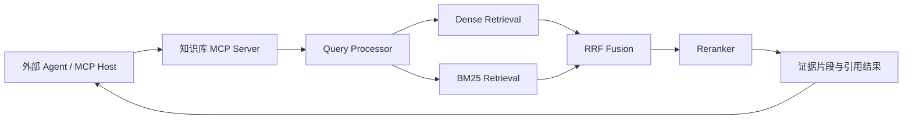
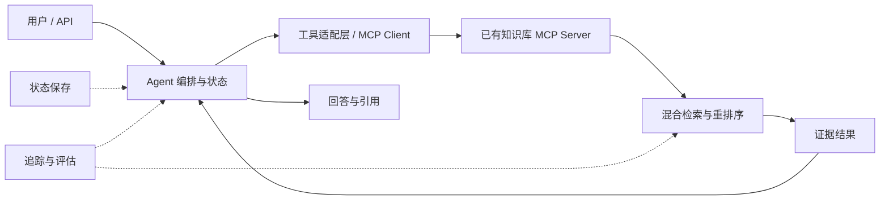

# 业界成熟 Agent 设计框架调研

核验日期：2026-10-08。依据：各项目的官方文档、官方发布说明、维护者仓库，以及你提供的 MCP 知识检索系统架构图。

收集范围：12 个开发框架、SDK 或框架组合，以及 Dify 应用平台。这里的“成熟”表示值得进入工程选型：有持续维护、明确的运行抽象和工程化路径。框架成熟度、某项功能是否稳定、你的应用是否能可靠上线，需要分别判断。本文没有进行性能实测，场景排序是根据官方能力和附件架构作出的工程判断。

对你的知识库项目，最值得先评估的是 **LlamaIndex、Haystack、LangGraph、Pydantic AI / OpenAI Agents SDK**。前两者解决数据和检索问题；后三者中选择一个，负责确实需要的 Agent 循环或任务编排。

## 框架清单与设计思路

| 框架 | 核心设计抽象 | 成熟度依据与工程特点 | 适用场景 | 对附件架构的价值与取舍 |
| --- | --- | --- | --- | --- |
| **LangGraph / LangChain** | LangGraph 用状态、节点、边表达执行过程；LangChain 提供模型、工具和 Agent 循环的高层接口 | LangGraph 有持久化、流式输出、人工介入和故障恢复基础；官方已发布稳定 v1，并披露企业采用情况 | 自定义业务流程、长任务、多轮工具调用 | 为查询改写、检索、证据检查和有限重试建立显式状态图；需要自行设计状态和节点边界。[官方概览](https://docs.langchain.com/oss/python/langgraph/overview)、[v1 发布](https://www.langchain.com/blog/langchain-langgraph-1dot0) |
| **OpenAI Agents SDK** | Agent、Runner、工具、handoff、agents-as-tools | Python / TypeScript；SDK 管理 Agent 循环，应用管理部署和存储；提供 MCP 集成、guardrails 和 tracing | 工具型助手、客服路由、轻量多 Agent 应用 | 很适合做知识库 MCP 的调用方；复杂长任务仍需明确存储、调度和恢复方案。[SDK 概览](https://developers.openai.com/api/docs/guides/agents/sdk)、[MCP 与 tracing](https://developers.openai.com/api/docs/guides/agents/integrations-observability) |
| **Microsoft Agent Framework** | 统一 Agent 抽象、会话状态、中间件、图式工作流 | .NET / Python 的 1.0 于 2026-04-03 发布，官方承诺稳定 API 和长期支持；是 AutoGen 与 Semantic Kernel 的直接后继 | .NET、Azure、企业应用集成、多 Agent 工作流 | 适合已有微软技术栈的团队；新项目应先评估该框架，并核对所选语言的功能覆盖。[框架概览](https://learn.microsoft.com/en-us/agent-framework/overview/)、[1.0 发布](https://devblogs.microsoft.com/agent-framework/microsoft-agent-framework-version-1-0/) |
| **Google ADK** | Agent 与工作流组合；确定性流程与动态委派结合 | 官方提供开发、调试、轨迹评估和部署路径，支持 Python / TypeScript / Go / Java；可部署到 Google Cloud 的 Runtime、Cloud Run 或 GKE | Google Cloud / Gemini 应用、企业助手、多 Agent 流程 | 适合云端运行和轨迹评估；语言和版本之间的工作流能力需分别核对。[Google Cloud 官方介绍](https://docs.cloud.google.com/gemini-enterprise-agent-platform/build/adk?hl=en) |
| **Strands Agents SDK** | 模型、系统提示、工具构成模型驱动循环；支持多 Agent 协作模式 | AWS 官方披露内部生产使用；支持多模型，提供 Graph、Workflow、Swarm 等模式及部署指南 | AWS / Bedrock 应用、工具自动化、模型自主选择步骤的任务 | 可调用知识库 MCP，适合 AWS 团队；严格固定的业务过程仍应显式控制。[架构与生产使用](https://aws.amazon.com/blogs/machine-learning/strands-agents-sdk-a-technical-deep-dive-into-agent-architectures-and-observability/)、[协作模式](https://docs.aws.amazon.com/prescriptive-guidance/latest/agentic-ai-frameworks/strands-agents.html) |
| **CrewAI** | Flow 管理流程和状态；Crew 组织角色、任务与协作 | 官方建议生产应用从 Flow 开始，再把需要自主协作的任务交给 Crew；Flow 有持久化机制 | 研究、报告生成、内容生产、角色明确的团队任务 | 对“检索—分析—写报告”易于表达；单次检索任务采用多角色团队通常收益有限。[架构概览](https://docs.crewai.com/en/introduction)、[Flow 与持久化](https://docs.crewai.com/en/concepts/flows) |
| **Pydantic AI** | 类型化 Agent、依赖、工具和输出；可组合图与执行后端 | 稳定 V2.0 于 2026-06-23 发布；有版本兼容政策；可接 Temporal、DBOS、Prefect 等持久执行方案 | Python 后端、结构化结果、多模型应用、需要明确输入输出契约的系统 | 适合为知识库查询定义可校验结果、引用和错误；持续执行能力应结合实际后端评估。[概览](https://pydantic.dev/docs/ai/overview/)、[版本政策](https://pydantic.dev/docs/ai/project/version-policy/)、[持久执行](https://pydantic.dev/docs/ai/capabilities/durable_execution/overview/) |
| **Claude Agent SDK** | 把 Claude Code 的 Agent 循环、工具和上下文管理作为库使用 | Python / TypeScript；提供文件与命令工具、hooks、subagents、MCP、权限及会话机制 | 编码助手、文件处理、工作区自动化 | 适合需要操作工作区的调用方；仅提供知识库查询时，工具执行环境的成本需要单独衡量。[官方概览](https://code.claude.com/docs/en/agent-sdk/overview) |
| **LlamaIndex** | 文档、节点、索引、Retriever、Query Engine；FunctionAgent / AgentWorkflow 和事件式 Workflows | 官方覆盖数据加载、索引、存储、查询和评估；Workflows 通过类型化事件连接步骤，可表达分支、循环和并发 | 知识库、文档助手、数据型 Agent、Agentic RAG | 与附件的摄取、查询、重排序和引用链路直接相关；可只引入检索组件。[RAG 架构](https://developers.llamaindex.ai/python/framework/understanding/rag/)、[Agent](https://developers.llamaindex.ai/python/framework/understanding/agent/)、[Workflows](https://developers.llamaindex.ai/python/llamaagents/workflows/) |
| **Haystack** | 可组合组件与 Pipeline；Agent 通过工具和运行状态执行任务 | Pipeline 支持分支、循环、异步执行；Agent 有状态、hooks、步数上限等控制；DocumentJoiner 提供 RRF | 企业搜索、可解释检索管线、可测量的 RAG | 非常贴合 Dense / BM25 → RRF → Reranker 管线，便于分别测量组件效果。[Pipeline](https://docs.haystack.deepset.ai/docs/pipelines)、[Agent](https://docs.haystack.deepset.ai/docs/agent)、[RRF](https://docs.haystack.deepset.ai/docs/documentjoiner) |
| **Spring AI** | ChatClient、Tool Calling、Advisor、VectorStore；与 Spring 应用集成 | 官方提供 Agent 设计模式、MCP 客户端与服务端集成，以及模型、工具周边的指标和追踪能力 | Java / Spring Boot 企业后端、已有服务的 AI 增强 | Java 技术栈可优先评估；应用集成能力与长任务编排运行时要分别判断。[设计模式](https://docs.spring.io/spring-ai/reference/api/effective-agents.html)、[MCP](https://docs.spring.io/spring-ai/reference/api/mcp/mcp-overview.html)、[可观测性](https://docs.spring.io/spring-ai/reference/observability/index.html) |
| **AgentScope** | ReAct 循环、Toolkit、Context、中间件、事件系统；服务层提供团队与会话能力 | 当前官方仓库为 2.0 路线，覆盖 MCP、权限、持久化和多模型；部分近期能力被标注为 Experimental | 国内模型生态、中文应用、团队协作、需要组合服务能力的项目 | 是值得验证的候选；新版本和实验能力应按具体模块评估。[维护者仓库与功能状态](https://github.com/agentscope-ai/agentscope)、[当前文档](https://docs.agentscope.io/) |

**补充：Dify 是应用平台。** 官方提供 Agent、Workflow、知识库、日志、API 集成和自托管路径。适合业务团队快速搭建和运营应用；已有代码体系中是否引入它，应根据平台运维和流程定制需求判断。[官方文档](https://docs.dify.ai/en/home)

## 选型时容易混淆的边界

- **LangChain、LangGraph、LangSmith 各有职责。** LangChain 提供高层 Agent 接口，LangGraph 提供编排运行时，LangSmith 提供追踪、评估和部署平台。LangGraph 可以独立于 LangChain 使用。[官方产品关系](https://docs.langchain.com/oss/python/langgraph/overview)
- **AutoGen、Semantic Kernel 的历史方案仍有参考价值。** 当前微软官方将 Microsoft Agent Framework 定位为二者的直接后继，并提供迁移指南；这不表示已有项目必须立即迁移。[官方说明](https://learn.microsoft.com/en-us/agent-framework/overview/)
- **MCP 解决连接与上下文交换。** 协议不规定应用如何使用模型或管理上下文，因此支持 MCP 本身不能证明具备计划、执行、记忆或恢复能力。[MCP 架构](https://modelcontextprotocol.io/docs/learn/architecture)
- **会话持久化与持续执行是两种能力。** 保存消息后能够继续聊天，并不自动保证进程中断后能正确接续某个运行。Pydantic AI 的文档明确区分了二者。[持久执行说明](https://pydantic.dev/docs/ai/capabilities/durable_execution/overview/)
- **SDK 与云运行平台需要分别选型。** 框架通常在应用进程里执行；云端运行、扩容和运维是额外选择，例如 Strands 的部署目标。[Strands 部署指南](https://strandsagents.com/docs/user-guide/sdk/deploy/)

## 可复用的 Agent 设计模式

以下表格把官方定义与适合你的知识库项目的应用建议放在一起。“项目应用”是本文的设计判断。

| 模式 | 执行形态 | 项目应用 |
| --- | --- | --- |
| 固定步骤链 / Prompt Chaining | 已知步骤按序执行，步骤间检查结果 | 查询预处理 → 检索 → 重排序 → 引用组装 |
| Routing | 分类后选择模型、工具或流程 | 按集合、文档类型或查询难度选择检索策略 |
| Parallelization | 独立分支同时执行，再汇总 | 多集合检索、独立分析任务；Dense / BM25 并行属于同类控制思路，但通常无需多 Agent |
| Orchestrator–Workers | 中央编排者动态拆解任务，调用执行者并综合结果 | 复杂问题需要跨多个来源查证时使用 |
| Evaluator–Optimizer | 生成、评估、反馈、再次生成 | 发现证据缺口后有限补查；设定清晰标准和次数上限 |

这些工作流模式在 Anthropic 的官方文章中有定义和适用条件，Spring AI 也提供实现示例。[Anthropic 设计模式](https://www.anthropic.com/engineering/building-effective-agents)、[Spring AI 示例](https://docs.spring.io/spring-ai/reference/api/effective-agents.html)

另外三种运行方式也值得明确：

- **工具调用循环**：模型选择工具，系统执行并回传结果，直到得到最终输出或触及停止条件。适合步骤无法预先完全确定的查询。[OpenAI Agent 循环](https://developers.openai.com/api/docs/guides/agents/running-agents)
- **Manager / Agents-as-tools 与 Handoff**：前者由主 Agent 保持最终回答的责任，后者把对话控制权交给专家 Agent。知识研究通常更适合主 Agent 汇总；专业客服路由可能更适合交接。[官方编排说明](https://developers.openai.com/api/docs/guides/agents/orchestration)
- **可恢复执行与人工介入**：通过状态保存、暂停和恢复控制长任务。是否需要人工介入取决于工具行为和业务规则；检索只读任务一般无需增加额外审核步骤。[LangGraph 能力](https://docs.langchain.com/oss/python/langgraph/overview)、[SDK guardrails 与审核](https://developers.openai.com/api/docs/guides/agents/guardrails-approvals)

## 与附件架构的对应关系

附件已有 MCP 接口、混合检索、重排序、响应构建、数据摄取、可插拔组件和追踪评估。主要执行路径是知识检索管线；外部客户端可以负责 Agent 循环。根据这一点，建议按两种目标选择结构。

**目标 A：让外部 Agent 使用你的知识库。**

这一目标优先考虑 **LlamaIndex 或 Haystack**。它们可以实现或增强 Core 与 Ingestion 层；MCP Server 保持清楚的工具契约。检索结果最好包含文档和片段标识、来源位置、内容及检索元数据，让调用方能够核验引用。具体的 RRF、向量库和 BM25 存储搭配仍需按实际实现验证。

**目标 B：自己提供能多轮检索、分析和回答的 Agent。**

Agent 编排层可以是独立调用方，也可以在同一应用中通过内部接口调用检索服务。选择 MCP 还是直接函数调用，应根据是否需要跨进程和对外复用决定。

本项目的候选组合：

| 优先目标 | 建议组合 | 原因 |
| --- | --- | --- |
| 完成可靠的知识库 MCP | 现有 MCP Server + LlamaIndex 或 Haystack | 先覆盖摄取、检索、重排序、引用和检索评估 |
| 管理明确的多轮查询流程 | LangGraph + 已有知识库工具 | 图中显式表达补查、失败分支、状态与停止条件 |
| Python 后端与结构化结果 | Pydantic AI + 已有知识库工具 | 类型化输入输出便于和业务服务集成 |
| 快速实现工具型 Agent | OpenAI Agents SDK + 已有知识库工具 | Agent 循环、MCP、handoff 和 tracing 路径清晰 |
| 需要研究团队共同产出报告 | CrewAI Flow + 按需加入 Crew | 外层控制状态和步骤，局部使用团队协作 |

这里的组合是根据附件需求作出的建议，尚未通过项目实测。不建议同时引入多个顶层 Agent 运行时；首先选择一个能够承担明确职责的框架。

## 可借鉴的工程设计原则

这些是结合框架能力和附件结构提出的项目建议，并非每个框架自动提供的保证。

1. **模型决定需要哪些证据，代码执行可确定的检索操作。** BM25、RRF、过滤和存储写入保留清楚的实现与参数。
2. **把工具结果设计为数据契约。** 统一成功、空结果、错误、超时和引用结构，减少模型猜测。
3. **区分运行状态、会话历史、长期记忆和知识索引。** 它们的保存周期、访问范围和检索方式不同。
4. **设置明确的执行预算。** 给补查和重试配置次数、时间和成本上限，并提供可解释的停止原因。
5. **恢复时考虑副作用。** 有状态快照也需要验证重复执行是否会重复写入；有副作用的工具应具备幂等设计。
6. **通过评估决定是否增加 Agent 数量。** 单 Agent、路由或多 Agent 的选择应由准确率、延迟和成本的变化证明。
7. **追踪覆盖完整路径。** 记录工具选择、检索参数、返回证据、引用检查、错误和成本；日志与 UI 按使用需求展示。
8. **对知识访问进行业务范围过滤。** 项目、用户和集合范围应由工具层明确执行。

## 最小选型验证

建议先选择一个检索方案和一个必要的编排方案，在同一批项目问题上比较。下面是建议验证的内容，不是已完成的测试。

| 验证任务 | 重点观察 |
| --- | --- |
| 文档标题、编号、专有词查询 | BM25 与语义检索是否互补 |
| 语义改写和多来源问题 | 召回质量、问题分解是否改善结果 |
| 没有足够证据的问题 | 是否准确表达缺口，是否正确停止 |
| 多轮追问 | 会话状态是否延续，集合过滤是否保持正确 |
| 工具超时或进程中断 | 错误处理、恢复与重复执行行为 |
| 引用核验 | 回答是否被对应片段支持，来源是否可定位 |

沿用附件中的 Hit Rate、MRR、Faithfulness，并补充端到端任务成功率、引用支持率、P95 延迟、模型与工具调用次数、单次任务成本。指标要分开分析，避免检索召回问题被回答流畅度掩盖。

本次调研完成了官方资料核验和架构对应分析；未安装框架、修改业务代码或运行比较实验。
