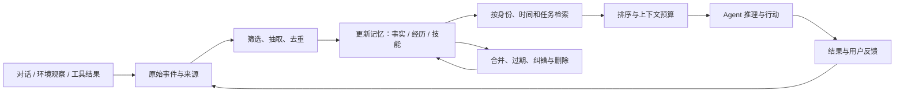

# Agent Memory 领域调研

调研日期：2026-10-07。范围：LLM Agent 的记忆机制、代表论文、评测方法、可接入产品与公开客户案例。论文年份按首次公开时间；产品能力按本次核验的官方文档和仓库描述。本文是资料调研，未实际部署各产品或复跑其基准。

## 1. 核心判断

Agent Memory 的核心，是让 Agent 把交互、环境和执行结果转化为可持续更新、可选择调用的状态，支持后续推理与行动。仅保存日志，通常还缺少写入筛选、更新、检索和使用策略。

当前研究可以从三个维度理解：记忆的载体（token、参数、潜在表示），用途（事实、经验、工作状态），以及动态过程（形成、演化、检索）。只分“短期/长期”不足以描述整个领域。[Memory in the Age of AI Agents](https://arxiv.org/abs/2512.13564)

我的判断是：

- **近期最容易落地的是跨会话事实、偏好和任务背景记忆。** Mem0、Supermemory、AgentCore Memory 等已提供直接接入路径。
- **时间与冲突处理决定长期可靠性。** “用户现在在哪家公司”与“用户去年在哪家公司”是不同问题，旧事实不能只靠相似度排序解决。
- **经验与技能记忆更接近 Agent 能力提升。** 需要把行动、结果、适用条件和反馈连接起来，评价是否减少重复失败。
- **复杂结构需要证明收益。** 两项 2026 年系统研究都展示了明显的场景差异与成本取舍，不能直接认定图结构或自主记忆管理总是优于简单检索。[跨系统实验](https://arxiv.org/abs/2606.24775)、[系统成本分析](https://arxiv.org/abs/2606.06448)
- **产品宣传分数需要按版本重读。** 论文实现、开源版本、托管平台和最新 SDK 可能已经不同。

上述是基于下文资料的工程判断，不能代替具体业务中的对照测试。

## 2. 基础知识与概念边界

### 2.1 按“记住什么”划分

下表是一组便于工程设计的分类；这些维度可能重叠，不是所有论文都采用同一术语。

| 类型 | 主要内容 | 例子 | 关键要求 |
| --- | --- | --- | --- |
| 工作记忆 Working | 当前目标、计划、约束、工具结果 | 调研到哪一步、还有哪些证据缺口 | 与运行状态一致，压缩后仍能继续 |
| 语义记忆 Semantic | 事实、偏好、实体关系 | 用户偏好中文；项目使用某数据库 | 能更新、能限定作用范围 |
| 情景记忆 Episodic | 某次经历及其时间、背景、结果 | 上次升级失败，回滚后恢复 | 保留来源与事件顺序 |
| 程序/技能记忆 Procedural | 可复用步骤、策略、代码 | 某类故障的排查流程 | 标明适用条件，用执行结果验证 |
| 前瞻记忆 Prospective | 在未来条件满足时执行的意图 | 客户回复后继续推进某任务 | 需要触发与调度机制，单纯检索不够 |

前三类及程序记忆可参考 [LangMem 核心概念](https://langchain-ai.github.io/langmem/concepts/conceptual_guide/)、[Voyager](https://arxiv.org/abs/2305.16291)；前瞻记忆有专门评测 [PM-Bench](https://arxiv.org/abs/2607.12385)。

另外两组设计维度同样重要：

- **作用范围：** 单次会话、单个用户、单个 Agent、项目、团队/组织。
- **表示形式：** 原始文本、摘要、结构化事实、链接笔记、知识图谱、可执行技能、参数或隐状态。

个人偏好、团队共识和 Agent 自己的工作经验，不能默认放进同一个没有范围边界的集合。

### 2.2 与相邻概念的关系

| 概念 | 主要解决的问题 | 与 Agent Memory 的关系 |
| --- | --- | --- |
| RAG | 从外部资料检索证据，再生成答案 | 是记忆读取的一种实现方法；加上交互写入、更新和生命周期管理后，可以构成记忆系统 |
| 长上下文 | 当前推理能够读入更多材料 | 能作为记忆读取方式和重要基线；跨会话保存、选取、更新仍需系统实现 |
| Context Engineering | 决定每次推理装入什么上下文 | 覆盖指令、资料、工具结果和记忆；Memory 是其中持续演化的部分 |
| Checkpoint / Workflow State | 恢复执行位置和程序状态 | 解决任务续跑；不自动提供跨任务知识与经验检索 |
| 微调/参数记忆 | 将知识或行为吸收到参数中 | 适合相对稳定的能力；用户级修改、删除和溯源通常更难 |
| KV Cache | 复用推理中的计算状态 | 能改善效率，但不能直接等同于用户事实、偏好和经验的长期记忆 |

RAG 可以处理动态数据，因此不宜把它概括成“只能检索静态文档”。更实用的区别是：一个系统是否持续管理来自交互的状态，并让状态影响后续行动。[概念综述](https://arxiv.org/abs/2512.13564)

订单是否已支付、账户权限、库存等业务真值，应以业务系统为准；记忆可以保存背景和历史线索，执行前仍应查询当前权威状态。这是本文的工程建议。

### 2.3 一个可实现的记忆闭环

这是综合文献后的参考架构，不是某个产品的精确实现图。

- **写入：** 判断哪些信息值得持久化。明确事实与推断应分开；记忆项保留来源、时间、归属、类型和状态。
- **更新：** 区分新事实、修正、撤销与历史版本。保存“何时有效”和“何时获知”，有助于回答现在与过去的问题。
- **读取：** 先确定身份和范围，再结合关键词、向量、时间过滤、实体关系，最后按任务相关性和 token 预算装入上下文。
- **维护：** 合并重复记录、处理过期信息、保留可回查证据，删除时处理摘要、索引与其他派生内容。
- **使用：** 衡量记忆是否被正确应用，而不仅是是否被检索到。

写入与维护可以放到后台，但异步处理有新鲜度代价：用户刚纠正一个事实，下一轮可能仍读到旧内容。2026 年系统论文专门讨论了构建成本与读取延迟之间的取舍。[系统分析](https://arxiv.org/abs/2606.06448)

### 2.4 主流技术路线

| 路线 | 优势 | 主要代价/失败点 |
| --- | --- | --- |
| 原始历史 + BM25/向量检索 | 写入便宜、证据完整、容易溯源 | 需要好的切分、检索和上下文预算 |
| 滚动摘要/分层摘要 | 压缩上下文，容易接入 | 连续压缩可能丢失日期、例外和细节 |
| 事实抽取 + 更新 | 适合用户画像、偏好、稳定事实 | 抽取错误、否定遗漏、过度归纳 |
| 图谱/关联笔记 | 组织实体关系、多跳线索与时间变化 | 建图、实体消歧和维护成本 |
| 反思 + 技能库 | 从任务结果提炼可复用经验 | 反思可能归因错误，技能可能不适用 |
| 学习记忆管理策略 | 联合优化写、读、更新与遗忘 | 训练、奖励设计和跨场景泛化 |

这些路线可以组合。图数据库负责组织关系，并不自动保证完整的时间推理和更新正确性。[A-MEM](https://arxiv.org/abs/2502.12110)、[Memory-R1](https://arxiv.org/abs/2508.19828)、[跨系统实验](https://arxiv.org/abs/2606.24775)

## 3. 代表论文与阅读价值

年份为首次公开时间。表内说明的是论文贡献；实验结果不自动代表今天对应产品的所有部署形态。arXiv 是获取论文的入口，不能仅凭链接判断其同行评审状态。

| 论文 | 年份 | 核心贡献 | 阅读时要关注的边界 |
| --- | --- | --- | --- |
| [Generative Agents: Interactive Simulacra of Human Behavior](https://arxiv.org/abs/2304.03442) | 2023 | 把经历记录、检索、反思和规划连接起来，形成连续行为 | 评价面向模拟行为可信度，不是企业任务成功率 |
| [Reflexion: Language Agents with Verbal Reinforcement Learning](https://arxiv.org/abs/2303.11366) | 2023 | 把任务反馈转化为文字反思，存入经验缓冲供后续尝试使用 | “Verbal RL”不等于更新模型权重；反馈可靠性很关键 |
| [MemoryBank](https://arxiv.org/abs/2305.10250) | 2023 | 长期对话记忆、用户理解，以及受遗忘曲线启发的更新机制 | 主要面向陪伴对话；遗忘启发式不必然适合业务记录 |
| [Voyager](https://arxiv.org/abs/2305.16291) | 2023 | 保存并检索可执行代码技能，通过执行反馈持续改进 | 是技能记忆的重要参考；实验环境是 Minecraft |
| [MemGPT: Towards LLMs as Operating Systems](https://arxiv.org/abs/2310.08560) | 2023 | 借鉴虚拟内存，让 Agent 调用工具管理不同记忆层 | 原始论文与今天 Letta 的 SDK 架构不能混用 |
| [Zep: A Temporal Knowledge Graph Architecture for Agent Memory](https://arxiv.org/abs/2501.13956) | 2025 | 时间知识图谱，融合对话与业务信息并保留历史关系 | 作者报告的结果对应论文设置；建图与维护也有成本 |
| [A-MEM: Agentic Memory for LLM Agents](https://arxiv.org/abs/2502.12110) | 2025 | 借鉴卡片笔记法，生成结构化笔记、建立关联并演化已有记忆 | 自动关联和改写需要检查，避免语义漂移 |
| [Mem0: Building Production-Ready AI Agents with Scalable Long-Term Memory](https://arxiv.org/abs/2504.19413) | 2025 | 从对话抽取、合并、检索重要信息，并研究图记忆变体 | 重点看基线与成本口径；2025 论文不等于 2026 云平台 |
| [Memory-R1](https://arxiv.org/abs/2508.19828) | 2025 | 用 RL 训练记忆管理与回答模块，学习 ADD/UPDATE/DELETE/NOOP 等操作 | 需要考察训练数据、奖励和跨任务泛化 |
| [Hindsight is 20/20](https://arxiv.org/abs/2512.12818) | 2025 | 区分世界事实、Agent 经历、综合观察和信念，提供 retain/recall/reflect | 事实与推断的区分很有价值；反思链路增加计算开销 |
| [Memory in the Age of AI Agents](https://arxiv.org/abs/2512.13564) | 2025，2026 修订 | 用形式、功能、动态过程梳理领域、基准与框架 | 适合建立全局地图 |
| [Agentic Memory / AgeMem](https://arxiv.org/abs/2601.01885) | 2026 | 将长期和短期记忆操作统一为 Agent 的工具动作，并用 RL 优化 | 从固定流水线走向可学习策略，工程落地要另行验证 |
| [Agent Memory: Characterization and System Implications of Stateful Long-Horizon Workloads](https://arxiv.org/abs/2606.06448) | 2026，9 月修订 | 分离构建、检索、生成的系统成本，分析多种实现 | 不要把某版本、某硬件上的结果推广到全部商业平台 |
| [Are We Ready For An Agent-Native Memory System?](https://arxiv.org/abs/2606.24775) | 2026 | 比较 12 个系统与 2 个基线，分析表示、抽取、检索路由和维护 | 无架构全面占优；作者包含产业方，需结合其他研究看结论 |

额外值得读的三个方向：

- **模型内部记忆：** [Titans: Learning to Memorize at Test Time](https://arxiv.org/abs/2501.00663) 研究测试时学习的神经记忆模块。它与调用闭源 LLM API 的外部记忆中间件处于不同技术层次。
- **记忆可靠性：** [MINJA](https://arxiv.org/abs/2503.03704) 展示查询交互可以污染某些 Agent 的记忆。工程启示是保留来源和信任边界，避免把外部文本直接变成持久行为规则。
- **经验与程序记忆：** [Remember Me, Refine Me](https://aclanthology.org/2026.findings-acl.829/)（Findings of ACL 2026）研究从成功、失败和对比中提炼经验，再按场景复用并根据效用修订。其 BFCL-V3 和 AppWorld 实验比单纯聊天回忆更接近任务能力评价；当前 ReMe 产品实现仍需单独核验。

建议阅读顺序：综述建立地图 → Generative Agents / MemGPT 理解基本架构 → Reflexion / Voyager 理解经验与技能 → Mem0 / Zep / Hindsight 对照工程方案 → 2026 系统研究理解成本 → Memory-R1 / AgeMem 理解学习式管理。

## 4. 如何评价“记忆有效”

### 4.1 主要基准

| 基准 | 主要测试什么 | 适合回答的问题 |
| --- | --- | --- |
| [LoCoMo](https://arxiv.org/abs/2402.17753) | 长期多会话对话的问答、事件总结和多模态对话 | 能否回忆并理解历史交互 |
| [LongMemEval](https://arxiv.org/abs/2410.10813) | 信息抽取、跨会话推理、时间推理、知识更新、信息缺失时不作答 | 能否正确处理个人历史和变化 |
| [MemoryAgentBench](https://arxiv.org/abs/2507.05257) | 增量多轮交互中的检索、测试时学习、长程理解和选择性遗忘 | 除了聊天记忆，还能否处理不同记忆任务 |
| [AMemGym](https://arxiv.org/abs/2603.01966) | 可交互的个性化场景，用户状态随交互演化 | Agent 的行动会影响后续交互时，记忆策略是否有效 |
| [LoCoMo-Plus](https://aclanthology.org/2026.acl-long.1150/) | 根据不直接点明的线索，应用用户状态、目标和价值约束 | 能否主动用对记忆，而非只答历史问题 |
| [PM-Bench](https://arxiv.org/abs/2607.12385) | 在未来提示或状态出现时执行先前意图 | 能否记住“到时候做什么” |

LoCoMo-Plus 和 PM-Bench 反映了一条值得关注的趋势：从“回忆答案”扩展到“在正确场景使用过去的信息和意图”。这是本文对评测方向的综合判断。

### 4.2 看排行榜时需要核对的条件

准确率应连同以下条件一起阅读：基准版本与子集、模型及版本、上下文预算、检索条数、评分器、重试次数，以及是否计算预先建库的成本。

两个分数都叫 LongMemEval Accuracy，并不保证采用相同数据版本、模型、检索预算或评分设置。Mem0 当前仓库明确表示，其托管平台分数包含开源 SDK 不具备的专有优化。[Mem0 仓库说明](https://github.com/mem0ai/mem0)

我的建议是保留三种基线：

1. 原始历史直接放入长上下文。
2. 原始历史配合关键词/向量检索和排序。
3. 少量用户画像、项目笔记或 Markdown 记忆，由 Agent 维护。

然后再与复杂记忆系统比较。简单方案能为新增抽取、建图与反思成本提供参照。2026 年系统研究强调构建成本可能占据生命周期成本的重要部分。[系统成本研究](https://arxiv.org/abs/2606.06448)

### 4.3 业务评测建议

这是建议方案，本文未执行这些实验。

| 维度 | 示例测试/指标 |
| --- | --- |
| 记得准确 | 关键事实精确率、证据召回、回答正确率 |
| 更新正确 | 偏好或事实被纠正后，是否继续调用旧版本 |
| 时间正确 | 分别问“现在”“上个月”“当时”，检查回答 |
| 使用有效 | 有记忆/无记忆的任务成功率差、重复失败次数 |
| 范围正确 | 用户、项目和团队信息是否被错误混用 |
| 遗忘有效 | 删除原记录后，摘要和索引是否仍泄露该信息 |
| 新鲜度 | 写入到可检索的延迟、纠错后的下一轮行为 |
| 运行成本 | 抽取、嵌入、建图、维护、检索、生成与存储总成本 |

## 5. 可接入产品和开源项目

“可接入”表示有公开服务、SDK 或部署路径；不等于本文已验证其生产可靠性。下表“适合场景”是根据能力形态给出的选型判断。

| 产品/项目 | 已核验的能力与形态 | 适合重点验证的场景 | 选型关注点 |
| --- | --- | --- | --- |
| [Mem0](https://docs.mem0.ai/introduction) / [仓库](https://github.com/mem0ai/mem0) | 跨会话记忆；有托管平台与 Apache-2.0 开源实现 | 个性化助手、客服、语音 Agent | 平台与 OSS 的算法、能力和评测结果存在差异 |
| [Zep](https://help.getzep.com/overview) / [Graphiti](https://github.com/getzep/graphiti) | Zep 云端组织对话、文档与业务数据；Graphiti 是开源时间图谱框架 | 客户/账户背景、关系与状态变化 | Graphiti 自建不等于完整 Zep 云服务；核对实体消歧、时间和运维成本 |
| [Letta](https://docs.letta.com/agent-sdk/memory) | 有状态 Agent；当前 SDK 提供 Git 支持的记忆文件、MemFS 和后台 dreaming | 长期任务、驻留工程助手、Agent 自主管理记忆 | 更接近 Agent 平台；当前 SDK 与旧 memory blocks 文档需要分开 |
| [LangMem](https://langchain-ai.github.io/langmem/) | 提取、合并、记忆工具和提示优化；支持前台与后台处理，集成 LangGraph Store | 已使用 LangGraph、希望自控存储的团队 | 是开发库；持久化、运行与权限边界仍需落地实现 |
| [Supermemory](https://supermemory.ai/docs/overview/what-is-supermemory) | 记忆、用户画像、检索和连接器；文档提供托管与自部署路径 | 多来源的用户/项目上下文 | 核对部署授权、隔离方式、导出和删除行为 |
| [Hindsight](https://github.com/vectorize-io/hindsight) / [Cloud](https://docs.hindsight.vectorize.io/) | retain/recall/reflect；结合语义、关键词、图与时间检索；有开源与托管形态 | 需要历史证据和反思的长期 Agent | 区分事实与推断；评估写入及反思成本 |
| [Cognee](https://github.com/topoteretes/cognee) | Apache-2.0；把文档、代码与对话组织成可检索知识图谱 | 企业知识、代码与关系较多的资料场景 | 数据知识化与用户记忆需求未必相同；检查图维护成本 |
| [MemOS](https://github.com/MemTensor/MemOS) | MemCube 与混合记忆思路；当前仓库列出 Cloud API、自建服务和本地插件 | 希望组合记忆形态、复用技能与自建服务的团队 | 论文目标与各部署形态的实有能力分别核验 |
| [EverOS，原 EverMemOS](https://github.com/EverMind-AI/EverOS) | Apache-2.0；本地优先，Markdown 为源数据，SQLite/LanceDB 索引，用户与 Agent 两条记忆轨道 | 个人与项目记忆、重视可读和可迁移数据 | 旧 EverMemOS 链接已跳转；应按当前实现评估 |
| [ReMe](https://github.com/agentscope-ai/ReMe) | 本地优先的记忆工具包；文件为持久数据，索引可重建；支持后台整合和程序经验记忆 | 希望定制工作流、保存可读记忆与复用经验 | 当前实现结合 BM25、可选向量和链接邻居；需按版本验证 |
| [Amazon Bedrock AgentCore Memory](https://docs.aws.amazon.com/bedrock-agentcore/latest/devguide/memory.html) | 完全托管；短期事件、长期事实/偏好/总结/情景策略 | 已在 AWS 上的生产 Agent | 评估区域、策略配置、异步可见性与生命周期成本 |

AWS 当前官方文档还说明：情景策略可以组织行动与结果，并跨情景生成反思。这表明托管服务正在从用户画像扩展到经验记忆。[内置策略文档](https://docs.aws.amazon.com/bedrock-agentcore/latest/devguide/long-term-configuring-built-in-strategies.html)

### 5.1 容易被旧资料误导的变化

- **Mem0：** 2025 论文、OSS SDK 和 2026 托管平台结果不能直接互换。最新仓库明确注明部分优化属于托管平台。[仓库](https://github.com/mem0ai/mem0)
- **Zep：** 当前文档强调企业统一上下文与 Context Graphs；Graphiti 是开源组件，不能据此推定拥有完整云端产品能力。[当前文档](https://help.getzep.com/overview)、[Graphiti](https://help.getzep.com/graphiti/getting-started/welcome)
- **Letta：** 旧文档强调 core memory blocks；当前 Agent SDK 讲述 Git 记忆仓库、按需读文件和 dreaming。阅读原始 MemGPT 论文时，应把理念与当前 API 分开。[当前 Memory 文档](https://docs.letta.com/agent-sdk/memory)
- **EverMemOS：** 当前官方仓库跳转到 EverOS，README 描述的是本地优先、Markdown 原生的可移植记忆层。[当前仓库](https://github.com/EverMind-AI/EverOS)

## 6. 有具名客户的落地证据

以下来自服务商发布的客户案例；它们支持“实际接入了记忆模块”，不构成对各平台的独立横向排名。整体 Agent 的业务收益，也不能全部归因于 Memory。

| 客户/应用 | 公开说明的记忆用途 | 对落地的启示 | 来源 |
| --- | --- | --- | --- |
| Druva / DruAI | AgentCore Memory 用于适应用户偏好的报告详略，并结合用户角色调整表达 | 用户偏好与角色记忆可以进入真实支持流程 | [AWS 客户案例](https://aws.amazon.com/solutions/case-studies/druva-agentcore-case-study/) |
| Trane | AgentCore Memory 保持故障排查会话背景，支持连续追问 | 记忆与业务工具结合，可以减少重复提供上下文 | [AWS 案例](https://aws.amazon.com/blogs/machine-learning/how-trane-gets-building-insights-60x-faster-with-amazon-bedrock-agentcore/) |
| KTern.AI | 在 SAP 项目中保留代码清单、流程决策、异常模式等项目背景 | 企业场景需要项目记忆，而不仅是个人喜好 | [AWS 案例](https://aws.amazon.com/blogs/machine-learning/how-ktern-ai-built-agentic-ai-for-sap-on-amazon-bedrock-agentcore/) |
| Scira | Supermemory 发布了从 Mem0 迁移其生产记忆层的案例，讨论索引、检索和集成适配 | 迁移评估要用真实工作流检查上下文是否可用 | [厂商案例与评测经验](https://supermemory.ai/blog/scira-memory-migration-evaluation-lessons/) |

Supermemory 另有 Adapta、Chatarmin 等公开案例，可作为产品场景线索；性能数字应按厂商案例口径理解。[案例目录](https://supermemory.ai/blog/tag/case-study/)

## 7. 工程选型与研究机会

### 7.1 按需求缩小候选集合

这是起始候选建议，不是性能排名。

| 需求 | 优先研究/验证 |
| --- | --- |
| 快速接入用户事实与偏好 | Mem0、Supermemory、AgentCore Memory |
| 追踪实体关系、事实变化和历史有效性 | Zep/Graphiti，并与原始历史检索比较 |
| 长期驻留 Agent，自主管理项目记忆 | Letta、Hindsight |
| 已采用 LangGraph，需要自控处理流程 | LangMem |
| 本地优先、可读、便于迁移的项目记忆 | EverOS，以及 Markdown + 简单索引基线 |
| 文档/代码知识组织与关系检索 | Cognee、Graphiti |
| 记忆生命周期与多形态组合研究 | MemOS、ReMe |
| 研究可学习的记忆操作 | Memory-R1、AgeMem、AMemGym |

建议先拿一组真实跨会话任务建立基线，再根据暴露的瓶颈选择能力：

- 检索不到原文：先处理切分、检索、排序。
- 查到旧事实：处理更新、时间和当前版本选择。
- 反复犯同类错误：研究情景反馈、经验总结和技能复用。
- 读到正确内容却没有执行：研究记忆使用策略和触发机制。
- 成本过高：把写入、维护、检索、生成分别计量。

### 7.2 值得持续关注的研究问题

下列是本文的综合判断：

1. **从召回走向任务收益。** 用后续行动成功率验证记忆，而不仅是历史问答。
2. **保留证据的压缩。** 摘要和事实抽取要减少 token，同时避免破坏日期、否定与适用条件。
3. **经验到技能的可靠转换。** 一次成功不能直接视为通用规律；需要条件和重复执行证据。
4. **可学习的写、读、更新与遗忘。** Memory-R1、AgeMem 展示了研究路径，泛化和训练成本仍需检验。
5. **主动应用与前瞻记忆。** 忆起约束、执行未来意图，需要与事件和任务调度连接。
6. **共享状态与可迁移记忆。** 多 Agent 的并发更新、不同项目的边界、用户可编辑与导出能力，都是系统问题。
7. **全生命周期效率。** 提高回答阶段速度，可能把开销移动到了抽取、建图和后台维护。

对于要做产品的团队，我建议优先找一个高频、跨会话、结果可验证的工作流，例如客户支持、项目故障排查或长期研究。把“记住”转化为“少重复收集信息、少重复失败、能继续任务”的可测收益，再决定是否建设通用记忆基础设施。
